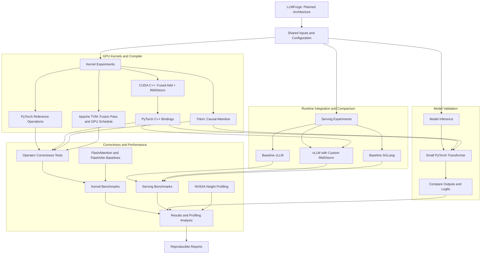

# LLMForge

GPU kernels, compiler optimizations, and reproducible benchmarks for LLM inference.

LLMForge investigates how low-level GPU optimizations affect language-model inference and serving. The project connects PyTorch references, CUDA C++ and Triton kernels, vLLM integration, Apache TVM compiler experiments, and comparisons with SGLang, FlashAttention, and FlashInfer.

**Project status:** Planning and initial scaffold. Features below are planned until marked complete. No performance improvements have been measured yet.

## Project Goals

- Build correct PyTorch reference implementations.
- Implement fused residual-add + RMSNorm in CUDA C++.
- Implement tiled causal attention in Triton.
- Expose CUDA kernels through PyTorch C++ bindings.
- Integrate a custom operation into vLLM.
- Implement an Apache TVM operator-fusion pass and GPU schedule.
- Benchmark SGLang as an additional inference runtime.
- Compare attention implementations against compatible FlashAttention and FlashInfer baselines.
- Profile GPU execution using NVIDIA Nsight.
- Publish reproducible correctness tests and performance results.

The central question is:

> When does a faster GPU kernel produce a faster end-to-end model response?

## Technology Stack

| Technology | Intended Use |
|---|---|
| Python | Reference implementations, runtime adapters, tests, benchmarks |
| C/C++ | PyTorch bindings and native kernel launchers |
| CUDA | Custom GPU kernels |
| PyTorch | Tensor operations, reference inference, correctness validation |
| Triton | Tiled attention implementation |
| vLLM | Custom-operation integration and inference serving |
| SGLang | Additional serving baseline |
| FlashAttention | Optimized attention baseline |
| FlashInfer | Compatible attention baseline and benchmarking utilities |
| Apache TVM | Graph fusion, lowering, and GPU scheduling |
| Nsight Systems | Execution timelines and launch overhead |
| Nsight Compute | Kernel-level performance analysis |

Optional extensions include MLC LLM, MLIR, CUTLASS DSL, cuTile, attention backward, and quantization.

## Architecture

The project has three related execution paths.

### Operator Experiments

Input tensors are processed by:

- PyTorch reference operations.
- Custom CUDA C++ kernels.
- Custom Triton kernels.
- TVM-generated kernels.

Outputs are validated before latency measurements are collected.

### Model Experiments

A small decoder-only transformer runs through a PyTorch inference path.

Selected reference operations are replaced with custom implementations. Fixed inputs are used to compare intermediate outputs, logits, and generated tokens.

### Serving Experiments

Matching request workloads are sent to:

- Baseline vLLM.
- vLLM with the custom normalization operation.
- Baseline SGLang.

Kernel speedups and serving improvements are reported separately.

The TVM experiment initially runs independently of vLLM. Benchmarking SGLang does not imply custom-kernel integration into SGLang.

## System Architecture



All components are planned. TVM runs as a separate compiler experiment. SGLang is a serving baseline; custom-kernel integration initially targets vLLM.

## Core Components

### 1. PyTorch Reference Implementations

Implement readable references for:

- Residual addition.
- RMSNorm.
- Scaled dot-product attention.
- Causal masking.
- Small transformer inference.

Start with tensor-level correctness, then add model-level validation.

Use fixed model weights, tokenizer revisions, dtypes, and generation settings when comparing inference paths.

### 2. CUDA Fused Residual-Add + RMSNorm

For input `x`, residual `r`, learned weight `w`, and stability constant `eps`:

```python
z = x + r
y = z * torch.rsqrt(
    torch.mean(z * z, dim=-1, keepdim=True) + eps
) * w
```

The initial operator returns `(y, z)` without modifying its inputs.

Planned implementation:

- Contiguous inputs with normalization over the last dimension.
- FP32 support first.
- FP16 and BF16 with FP32 accumulation where supported.
- Parallel reductions.
- Vectorized memory access where alignment permits.
- Thread/block tuning by hidden dimension.
- Support for widths that are not multiples of block dimensions.
- Explicit shape, dtype, device, and layout validation.
- Execution on the active PyTorch CUDA stream.

The optimization hypothesis is that fusion reduces launch overhead and intermediate memory traffic.

This must be tested against both an unfused reference and a strong optimized baseline.

### 3. Triton Causal Attention

Implement:

```text
O = softmax(Q @ K.T / sqrt(head_dim) + causal_mask) @ V
```

Use tiled computation and online softmax to avoid materializing the full attention-score matrix.

Initial scope:

- Forward pass.
- Equal numbers of query, key, and value heads.
- Fixed documented tensor layout.
- Causal masking.
- No dropout.
- Explicitly supported head dimensions.

Later extensions:

- Grouped-query attention.
- Variable-length sequences.
- KV-cache-aware decode attention.
- Backward pass.

Compare matching workloads against:

- Explicit PyTorch attention.
- PyTorch scaled-dot-product attention.
- Compatible FlashAttention implementations.
- Compatible FlashInfer implementations.

Tiled attention with online softmax alone should not be described as a complete FlashAttention-2 implementation. That claim requires implementing and documenting the relevant algorithmic techniques.

### 4. vLLM Integration

Integrate the custom normalization kernel into one pinned vLLM version.

Required checks:

- Custom operation registers successfully.
- Model inference actually executes the custom kernel.
- Numerical validation passes.
- Unsupported inputs use a documented fallback.
- Baseline and modified runs use matching compilation settings.
- CUDA graph compatibility is tested if supported.

Use profiler traces or execution counters to prove integration.

Importing a kernel module does not establish that vLLM uses it.

### 5. Apache TVM Compiler Optimization

Implement a compiler experiment for the residual-add + RMSNorm pattern.

Planned work:

1. Construct an unfused graph.
2. Identify the supported operation pattern.
3. Rewrite it into a fused operation.
4. Lower the operation for a CUDA target.
5. Implement and tune a GPU schedule.
6. Inspect transformed IR and generated code.
7. Compare correctness and performance.

Test both valid matches and cases where fusion must be rejected.

The compiler milestone requires a rewrite and schedule implemented in this repository, beyond simply running a model through TVM.

## Repository Structure

| Path | Purpose |
|---|---|
| `models/transformer.py` | Small reference transformer |
| `models/reference_ops.py` | PyTorch reference operations |
| `kernels/cuda/fused_add_rmsnorm.cu` | CUDA kernel |
| `kernels/cuda/fused_add_rmsnorm.h` | Kernel declarations |
| `kernels/triton/attention.py` | Triton attention kernel |
| `bindings/torch_extension.cpp` | PyTorch C++ bindings |
| `runtimes/pytorch_runner.py` | Reference inference runner |
| `runtimes/vllm_custom_op.py` | vLLM custom-operation adapter |
| `runtimes/sglang_runner.py` | SGLang baseline runner |
| `compiler/tvm/fuse_add_rmsnorm.py` | TVM fusion rewrite |
| `compiler/tvm/schedule_rmsnorm.py` | TVM GPU schedule |
| `benchmarks/bench_rmsnorm.py` | Normalization benchmark |
| `benchmarks/bench_attention.py` | Attention benchmark |
| `benchmarks/bench_serving.py` | Serving benchmark |
| `tests/test_rmsnorm.py` | Normalization correctness tests |
| `tests/test_attention.py` | Attention correctness tests |
| `tests/test_compiler_fusion.py` | Compiler equivalence tests |
| `docs/architecture.md` | Implementation decisions |
| `docs/benchmark_methodology.md` | Measurement protocol |
| `docs/profiling.md` | Profiling observations |
| `results/` | Raw benchmark results |
| `pyproject.toml` | Packaging and dependencies |
| `CMakeLists.txt` | Optional native build configuration |

Add model and runtime integration tests as those components are implemented.

## Hardware Requirements

CUDA execution requires an NVIDIA GPU supported by the selected software versions.

A Mac can be used for editing and CPU reference tests. NVIDIA CUDA kernels must run on an NVIDIA development machine or remote GPU environment.

An H100 is not required to begin.

### Development Options

- Local NVIDIA GPU machine.
- University GPU cluster such as USC CARC.
- Kaggle GPU notebook for initial experiments.
- Remote GPU server.

Available memory determines feasible model sizes, context lengths, and batch sizes.

For CARC, obtain an active project allocation and request a GPU compute session through Slurm. Run GPU workloads on the allocated compute node.

For Kaggle, inspect the assigned GPU, compiler availability, and package compatibility before choosing supported experiments.

## Environment Setup

### Create a Python Environment

From the project directory:

```bash
python3 -m venv .venv
source .venv/bin/activate
python -m pip install --upgrade pip
```

### Check GPU Tooling

On the NVIDIA development machine:

```bash
nvidia-smi
nvcc --version
```

### Install PyTorch

Use the official PyTorch installation selector to install a CUDA-enabled build compatible with the environment.

Check installation:

```bash
python -c 'import torch; print("PyTorch:", torch.__version__); print("CUDA build:", torch.version.cuda); print("CUDA available:", torch.cuda.is_available())'
```

### Configure Project Packaging

Before editable installation is supported:

- Implement the build configuration in `pyproject.toml`.
- Configure package discovery.
- Define test dependencies.
- Choose a CUDA extension build mechanism.
- Record tested package versions.

The intended installation interface is:

```bash
# Available after packaging is implemented.
python -m pip install -e '.[dev]'
```

Use separate pinned environments for runtimes or compiler tools when dependencies conflict.

Do not assume that arbitrary latest versions of every framework are mutually compatible.

## Planned Usage

The commands below describe the intended CLI.

**They will work only after the corresponding scripts and packaging are implemented.**

### Correctness Tests

```bash
python -m pytest tests/test_rmsnorm.py -q
python -m pytest tests/test_attention.py -q
python -m pytest tests/test_compiler_fusion.py -q
```

### Normalization Benchmark

```bash
python -m benchmarks.bench_rmsnorm \
  --dtype float16 \
  --rows 1 32 256 \
  --hidden-sizes 768 2048 4096 \
  --warmup 100 \
  --iterations 1000 \
  --output results/rmsnorm.json
```

### Attention Benchmark

```bash
python -m benchmarks.bench_attention \
  --dtype float16 \
  --batch-sizes 1 4 \
  --seq-lengths 128 512 2048 \
  --head-dim 64 \
  --causal \
  --output results/attention.json
```

### Reference Model Inference

Replace the example identifiers with a supported model and pinned revision:

```bash
python -m runtimes.pytorch_runner \
  --model YOUR_MODEL_ID \
  --revision YOUR_MODEL_REVISION \
  --prompt "Explain GPU memory in two sentences." \
  --max-new-tokens 64
```

### Serving Benchmark

Run against an already-started compatible server:

```bash
python -m benchmarks.bench_serving \
  --base-url http://localhost:8000/v1 \
  --model YOUR_SERVED_MODEL_ID \
  --input-tokens 512 \
  --output-tokens 128 \
  --concurrency 1 4 16 \
  --requests 100 \
  --output results/serving.json
```

Document runtime launch commands and custom-operation loading instructions for the pinned versions.

## Correctness Testing

### Normalization Tests

- Compare normalized and residual outputs against a higher-precision reference.
- Test different row counts and hidden dimensions.
- Include odd widths and tile boundaries.
- Test zero inputs and varied input magnitudes.
- Validate supported dtypes.
- Check input preservation.
- Check unsupported layouts and invalid inputs.
- Report absolute and relative error.

Use documented dtype-specific tolerances.

### Attention Tests

- Validate causal masking and scaling.
- Test sequence lengths across tile boundaries.
- Check supported head dimensions.
- Test numerical stability.
- Compare against matching reference semantics.
- Explicitly reject unsupported configurations.

If backward is implemented, compare gradients as well.

### Compiler Tests

- Confirm supported patterns are fused.
- Confirm invalid patterns are not fused.
- Compare fused and unfused outputs.
- Inspect generated IR and kernel execution.

### Runtime Tests

- Confirm the custom kernel executes during inference.
- Compare logits on fixed inputs.
- Check fallback behavior.
- Validate supported compilation and CUDA graph settings.

## Benchmark Methodology

### Kernel Benchmarks

- Use identical inputs and operation contracts.
- Record tensor shapes, dtypes, and configuration.
- Allocate inputs outside the timed region.
- Disclose whether output allocation is timed.
- Exclude compilation and autotuning from steady-state measurements.
- Measure cold-start overhead separately.
- Warm up each implementation.
- Use CUDA events or a GPU-aware benchmark utility.
- Report median latency and measurement variability.
- Record hardware and software versions.

Compare against both a readable reference and an optimized baseline.

### Serving Benchmarks

Keep the following fixed where comparable:

- Model weights and revision.
- Tokenizer revision.
- Precision.
- GPU.
- Input workload.
- Generation settings.
- Prompt and output lengths.
- Concurrency.
- Memory configuration.
- Compilation and caching settings.

Disclose scheduler and runtime differences.

| Metric | Meaning |
|---|---|
| Time to first token | Request start to first output token |
| Inter-token latency | Time between output tokens |
| End-to-end latency | Request start to completed response |
| Output throughput | Generated tokens per measurement second |
| Request throughput | Completed requests per second |
| Peak GPU memory | Peak usage under a documented measurement method |
| Reliability | Completed, failed, and rejected requests |

Report p50 and p95 latency and time to first token.

Document how streaming chunks are converted into token timing measurements.

Store actual token counts rather than assuming requested output lengths were produced.

### Improvement Calculations

```text
Speedup =
    baseline latency / custom latency

Latency reduction (%) =
    100 * (baseline latency - custom latency) / baseline latency

Throughput increase (%) =
    100 * (custom throughput - baseline throughput) / baseline throughput
```

Specify the metric, workload, and baseline for every improvement claim.

## Results

No measurements are available yet.

| Experiment | Baseline | Candidate | Result |
|---|---|---|---|
| Normalization | PyTorch eager / compiled | CUDA C++ fused kernel | Not measured |
| Attention | Matching PyTorch / library baseline | Triton kernel | Not measured |
| Compiler fusion | Unfused TVM graph | Fused TVM graph | Not measured |
| Runtime integration | Baseline vLLM | Modified vLLM | Not measured |
| Runtime comparison | vLLM | SGLang | Not measured |

For every published result, record:

- Repository commit.
- GPU model and memory.
- Driver and CUDA versions.
- Framework and compiler versions.
- Model and tokenizer revisions.
- Tensor shapes and dtypes.
- Runtime configuration.
- Warmup and repetition counts.
- Timing method.
- Correctness results.
- Raw measurements.

Kernel speedups must not be presented as end-to-end serving speedups.

## Profiling

### Nsight Systems

Investigate:

- CPU/GPU execution timeline.
- Kernel launch overhead.
- Synchronization.
- Idle periods.
- Custom-kernel execution during serving.

### Nsight Compute

Investigate:

- Memory throughput.
- Register pressure.
- Occupancy.
- Execution stalls.
- Reduction and memory-access behavior.

For each optimization, document:

1. Observed bottleneck.
2. Proposed change.
3. Profiling evidence.
4. Correctness outcome.
5. Benchmark outcome.
6. Tradeoffs and limitations.

Collect primary timing results separately from profiling runs.

## Implementation Roadmap

- [ ] Implement PyTorch reference operations.
- [ ] Add normalization correctness tests.
- [ ] Implement CUDA fused residual-add + RMSNorm.
- [ ] Expose the kernel through C++ bindings.
- [ ] Publish a reproducible normalization benchmark.
- [ ] Integrate the operation into a pinned vLLM version.
- [ ] Validate actual runtime execution and model outputs.
- [ ] Implement Triton causal attention.
- [ ] Compare matching attention library baselines.
- [ ] Implement TVM fusion and GPU scheduling.
- [ ] Add controlled SGLang serving comparisons.
- [ ] Profile selected kernel and serving workloads.
- [ ] Publish tested installation instructions and raw results.

The first milestone is a correct CUDA normalization kernel with reproducible measurements.

## Optional Extensions

### Training Support

Implement an attention backward pass and validate it in a small PyTorch training loop.

### Decode Attention

Add KV-cache-aware attention and evaluate decode separately from prefill.

### MLC LLM

Compile and deploy a supported model. Distinguish deployment usage from compiler modifications.

### CUTLASS DSL

Implement a GEMM or fused GEMM epilogue and compare matching workloads.

### MLIR

Implement a standalone lowering or fusion experiment with IR inspection and correctness tests.

### cuTile

Implement a supported tiled operation and benchmark it against CUDA or Triton.

### Quantization

Specify the quantization format, validate numerical behavior, and measure model-quality changes.

Mark extensions complete only after their implementation and validation.

## Contributing

Contributions can include:

- Correctness tests.
- Benchmark reproduction.
- GPU profiling analysis.
- Kernel improvements.
- Compiler optimizations.
- Runtime integration fixes.
- Documentation.

Performance-related changes should include matching baseline measurements, hardware details, and correctness evidence.

Credit adapted code and algorithms and preserve applicable upstream licenses.

## License

A license has not been selected yet.

Add a `LICENSE` file before publishing the project as licensed open source.

## References

- [PyTorch Installation](https://pytorch.org/get-started/locally/)
- [PyTorch C++ / CUDA Extensions](https://docs.pytorch.org/docs/stable/cpp_extension.html)
- [Triton Fused Attention Tutorial](https://triton-lang.org/main/getting-started/tutorials/06-fused-attention.html)
- [FlashAttention](https://github.com/Dao-AILab/flash-attention)
- [FlashInfer](https://docs.flashinfer.ai/)
- [vLLM Custom Operations](https://docs.vllm.ai/en/stable/design/custom_op/)
- [SGLang](https://docs.sglang.ai/)
- [Apache TVM](https://tvm.apache.org/docs/)
- [MLC LLM Compilation](https://llm.mlc.ai/docs/compilation/compile_models.html)
- [NVIDIA Nsight Systems](https://developer.nvidia.com/nsight-systems)
- [NVIDIA Nsight Compute](https://developer.nvidia.com/nsight-compute)

## Skills Demonstrated After Completion

Python, C/C++, PyTorch, CUDA, Triton, GPU kernel development,
kernel fusion, LLM inference, vLLM integration, SGLang benchmarking,
Apache TVM, ML compiler optimization, attention algorithms,
NVIDIA Nsight profiling, correctness testing, and reproducible
performance analysis.

Completed implementations and published measurements provide the evidence for these skills.
